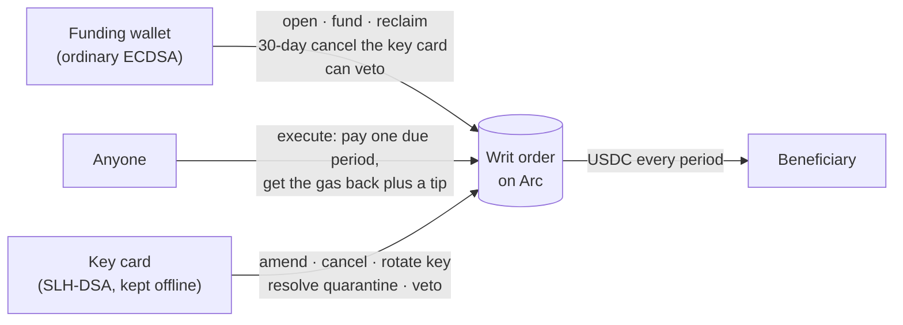
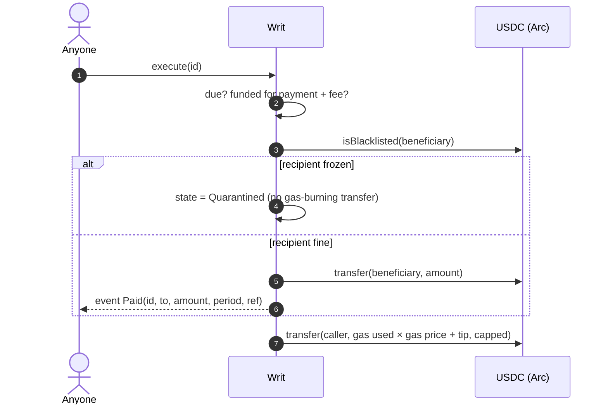
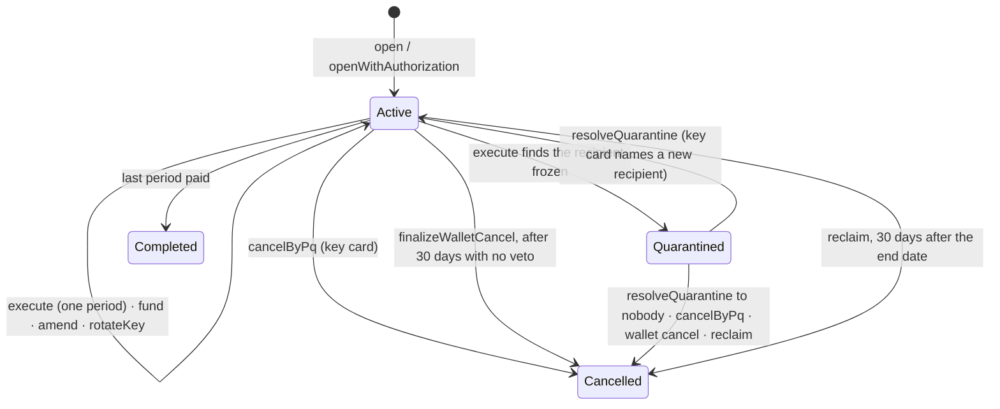

# Writ

**What's written, stays written.**

A standing USDC payment order on Arc. You fund it once and it pays itself on schedule.
Only a post-quantum key card, verified on-chain by Arc, can change or cancel it. The
wallet that funded the order has no way to change it.

| | |
| --- | --- |
| **Live app** | **[projectwrit.vercel.app](https://projectwrit.vercel.app)** |
| **Live order** | [order #1](https://projectwrit.vercel.app/order/1): 0.01 USDC a day on Arc mainnet until 2026-11-01 |
| **Contract** | [`0x9701970268ee7a5933a2d688d25f143d5099a3db`](https://explorer.arc.io/address/0x9701970268ee7a5933a2d688d25f143d5099a3db) on Arc mainnet · verified: [Sourcify](https://repo.sourcify.dev/5042/0x9701970268ee7a5933a2d688d25f143d5099a3db) exact match · [Etherscan](https://arc.etherscan.io/address/0x9701970268ee7a5933a2d688d25f143d5099a3db#code) |
| **Spec** | [ARCHITECTURE.md](ARCHITECTURE.md): the full build document, with the command behind every chain fact |

> *Writ*: an order issued by one authority and carried out by someone else. It is also
> the old past participle of *write*.

---

## The idea: three powers, held apart

Most payment tools let one key do everything. Writ splits the power three ways, and
**the split is the product**:



| Power | Who holds it | What it can do |
| --- | --- | --- |
| **Fund** | the payer's wallet | Open and top up an order. It **cannot** change the recipient, the amount or the period, and it cannot stop payments. No function in the contract lets it. |
| **Execute** | anyone | Pay a due period. The order refunds the caller's gas plus a tip, capped by the order. No keeper or server is needed. |
| **Amend** | the key card | Change, cancel or re-key the order. Each action needs a 7,856-byte `SLH-DSA-SHA2-128s` signature that Arc's precompile verifies on-chain. |

If someone steals your everyday wallet, they still can't redirect your payroll: the power to
redirect lives on a different key, under different cryptography, and that key was never
on the compromised machine.

---

## Try to steal it

Open the [live order](https://projectwrit.vercel.app/order/1) and press **Try to hijack
this order**. The app runs what a thief holding the funding wallet would try, as free
`eth_call` simulations against the live contract. Nothing is signed and nothing is sent.

| The thief tries to… | What the chain says |
| --- | --- |
| Send all future payments to their own address | **Blocked**: it needs this order's key card |
| Cancel the order and take a refund | **Blocked**: it needs the key card |
| Replace the key card with their own | **Blocked**: it needs the key card being replaced |
| Pull the money out right now | **Blocked**: it needs 30 days' public notice, which the key card can veto |

If a payment is due, you can also press **Pay now**: anyone can, and the order refunds you.

---

## How one payment works



USDC is Arc's gas token, so the caller's gas is refunded **in the same asset as the
payment**. That makes an order's runway an exact dollar count, gas included.

## The life of an order



---

## Why the key card guards the rule, not the payment

A post-quantum signature is required only to **change the rule**, never to move money
under it. After the order exists, payments are permissionless and cost a fraction of a
cent, so the expensive key is needed almost never.

Measured on Arc mainnet against the live contract, at 21 gwei:

| Action | Who | Gas | Cost | Receipt |
| --- | --- | ---: | ---: | --- |
| Open and fund (one tx, EIP-3009) | payer | 285,555 | $0.0060 | [tx](https://explorer.arc.io/tx/0x48bfe9ce5daa9b29d406b047099199fda855c116bdba6713788ba3fb9ded0297) |
| Pay one period (`execute`) | anyone | 125,895 | $0.0026, refunded | [tx](https://explorer.arc.io/tx/0xd9044d50ad0d879d142b855c8ec8e646a647e3749879ca8848200a6277a1af12) |
| Key card action (`rotateKey`, verified on-chain) | key card | 398,989 | $0.0084 | [tx](https://explorer.arc.io/tx/0xed7c7e26aff4bafea5ce7625a985023b21c5376fd3f44fab5423b19abae0b9b3) |

Take a monthly order that runs for 10 years, so 120 payments. With Writ, the key card is
needed **0–3 times**. With a signature on every payment, it is needed **120 times**,
and someone has to be present each time to get paid.

---

## What it uses Arc for

| Arc feature | How Writ uses it |
| --- | --- |
| **Post-quantum signature precompile** `0x1800…0004` | Verifies every amendment, cancellation and key rotation on-chain with `SLH-DSA-SHA2-128s` |
| **USDC as native gas** | The executor fee is refunded and reserved in USDC, the same asset as the payment |
| **USDC blocklist** (`isBlacklisted`) | Read free before each payment. A frozen recipient becomes a logged `Quarantined` state instead of a gas-burning revert |
| **EIP-3009** `receiveWithAuthorization` | Opens and funds an order in one transaction, with no `approve` step |
| **Deterministic finality** | A payment is final when its receipt arrives |

### Five things about Arc we measured that aren't in the docs

Every one comes with its reproduction command in [§3 of the spec](ARCHITECTURE.md).

1. **`CallFrom` only accepts allowlisted callers**, and it also requires `sender == tx.origin`. So no contract can use Arc's Memo or Multicall3From predeploys, which is why Writ carries its reference in its own `Paid` event.
2. **The PQ precompile reverts on bad lengths** instead of returning false. `vk` must be exactly 32 bytes and `sig` exactly 7,856. Writ checks the length first, so callers get a clear error.
3. **Arc accepts only "pure" SLH-DSA** (FIPS 205) and rejects the "internal" variant without saying so. A signer that uses the wrong one fails on every signature.
4. **The public RPC isn't an archive node.** Historical `eth_getLogs` fails, so the app reads current state through view functions.
5. **On an anvil fork, the real USDC half-works.** `balanceOf` works, while `transfer` and `isBlacklisted` revert. So the fork tests replay the real precompile's verdict instead (see Tests).

---

## The app

The app is a static site with no backend and no indexer. It reads Arc mainnet directly,
and key cards are created and used in the browser.

| Page | What you can do |
| --- | --- |
| [`/`](https://projectwrit.vercel.app) | See the live order card, read straight from the chain |
| [`/how`](https://projectwrit.vercel.app/how) | See the three ideas, each with a link to check it on-chain |
| [`/open`](https://projectwrit.vercel.app/open) | Create an order: set who gets paid, how much and how often, make a key card, then sign once |
| [`/order/:id`](https://projectwrit.vercel.app/order/1) | See its progress and pay it if due, try to hijack it, use the key card, or manage it as the payer |

**Key cards** are generated in the browser and never sent anywhere. A card is saved as a
file encrypted with AES-GCM, using a key derived from your password with PBKDF2-SHA256
(600,000 iterations). Signing runs in a Web Worker using `@noble/post-quantum`.

## Repository

```
contracts/   Writ.sol (one file: no owner, no proxy, no pause) + Foundry tests
shared/      TypeScript digest and nonce code, byte-matched to the contract with fixtures
scripts/     deploy, rehearse (free eth_call dry run), demo flow, optional keeper
web/         the app (Vite + React + wagmi)
deployments/ addresses, transactions and verification records
```

## Tests

**212 passing:** 119 Solidity (local) · 7 against live Arc testnet · 22 TypeScript parity · 64 web.
The suites include 5 fuzzed invariants and an adversarial audit suite
(`WritAudit.t.sol`). Every function, custom error and event in the contract is exercised.

```sh
npm ci && npm --prefix web ci
npm test                  # TypeScript digest + nonce parity with the contract
npm run test:sol          # Solidity: unit, adversarial, audit, invariant
npm run test:fork         # Solidity against LIVE Arc testnet
npm --prefix web test     # web
```

> A plain `forge test` **skips** the fork tests. Run `npm run test:fork` to put real
> signatures in front of Arc's real precompile. A forge fork can't execute Arc's native
> precompiles, so the test asks the live node for the verdict and replays it with an
> exact-calldata mock. A passing test therefore proves Writ sent exactly the bytes Arc
> judged.

## Deployed version

The deployed contract **is** this repo, built from this source. Sourcify reports an
exact match on both the creation and the runtime bytecode, [Etherscan shows the source
and ABI](https://arc.etherscan.io/address/0x9701970268ee7a5933a2d688d25f143d5099a3db#code),
and `npm run sync -- --mainnet` refuses to pass unless the local build, the deployment
record and the chain all agree:

```
repo build   0x0079d64ba2f5d3c6b3dc71359ce113527815d69e9a83650f3a55092642b3cb3c
deployed     0x0079d64ba2f5d3c6b3dc71359ce113527815d69e9a83650f3a55092642b3cb3c
```

Superseded: [`0xFF70bc435C29400Fe5c988B92dcc6c17d98B5652`](https://explorer.arc.io/address/0xFF70bc435C29400Fe5c988B92dcc6c17d98B5652).
It predates the fix for an order's last payment leaving the executor no fee, so nobody
would have triggered it (§5.4). The ABI did not change.

## What it does not claim

- **Spending isn't quantum-safe.** Funding and execution use ordinary ECDSA. The post-quantum property covers **changing the order** only.
- **`reclaim` doesn't pay overdue periods first.** Thirty days after the end date, the payer can take back what is left, including due payments nobody collected. The app shows the beneficiary a **collect before** date.
- **No protection if both keys are compromised.**
- **Circle can freeze the contract.** That is unavoidable on a chain whose native asset is USDC.
- **No yield on idle balances**, and **no users yet**: this is a proof of concept with one real order running.
- **Arc has no searchers yet**, so `npm run keeper -- --mainnet --id 2` (or `--once` under cron) keeps a demo order paid on time.

## Prior art

Other projects use the same precompile, and Writ builds on two of them. It borrows the
30-day exit from [`arc-guard`](https://github.com/Jayanthkoppala/arc-guard) and the
testing approach from [`pq-provenance`](https://github.com/0xHUMAN-AI/pq-provenance).
Also see [`interlock`](https://github.com/Iniwura/interlock),
[`ArcMandate`](https://github.com/efeberk21/ArcMandate) and
[`leash`](https://github.com/ngjupeng/leash). [§16 of the spec](ARCHITECTURE.md) compares
them in detail.

## Network

| | |
| --- | --- |
| Arc mainnet | chain `5042` · `https://rpc.mainnet.arc.io` · [explorer.arc.io](https://explorer.arc.io) |
| Arc testnet | chain `5042002` · `https://rpc.testnet.arc.io` · [explorer.testnet.arc.io](https://explorer.testnet.arc.io) |

## Licence

MIT. See [LICENSE](LICENSE).
