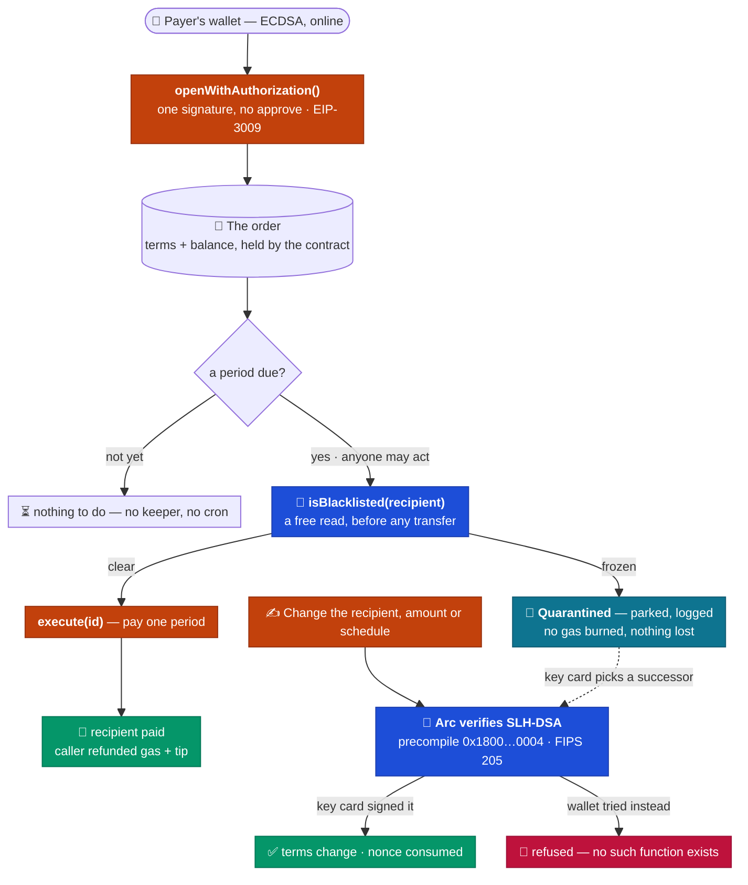
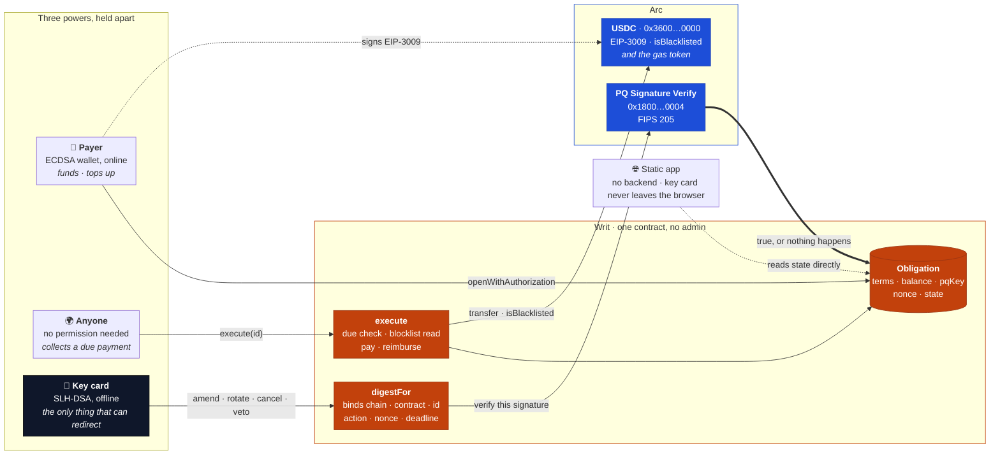

<div align="center">

# 📜 Writ

### A recurring USDC payment that not even your own wallet can redirect.

**Every standing payment ever built has one key that can reroute it.** Phish that key and every future salary, rent cheque or vesting instalment lands in someone else's account. Writ takes that power away from everyone — including the wallet that funded the order. Changing where the money goes needs a **post-quantum key card** you keep offline, and **Arc verifies it on-chain**. There is no function the wallet can call instead.


🌐 **[Live app](https://projectwrit.vercel.app)** · 📄 **[Architecture](ARCHITECTURE.md)** · ✅ **[Contract on Arc](https://arc.etherscan.io/address/0x9701970268ee7a5933a2d688d25f143d5099a3db#code)** · 🧾 **[Live order #1](https://projectwrit.vercel.app/order/1)**

</div>

---

## The problem

A recurring payment is a promise about the future. Every system that makes one keeps a key that can break it.

A card on file: one phished login and the payout address is theirs. A multisig: one compromised signer short of threshold and you are negotiating, not paying. A smart-contract subscription: whoever holds the owner key points it anywhere, instantly.

The money is correct right up to the moment somebody else holds the key. And the loss is not one payment — it is **every payment from then on**, usually discovered a month later by the person who stopped being paid.

Making the key harder to steal does not fix this. The key is allowed to do it.

## What Writ is

A standing USDC order whose **three powers are held by three different things**, so no single stolen credential can redirect the money.

| Power | Who holds it | What they can do |
|---|---|---|
| 💰 **Fund** | your ordinary wallet (ECDSA) | put money in — and nothing else |
| ▶️ **Execute** | anyone at all | pay a period that is due, and keep a tip for it |
| ✍️ **Amend** | one SLH-DSA key card, kept offline | change the recipient, amount, schedule — or cancel |

The wallet that created the order **cannot** redirect it. Not "is not allowed to" — there is no function that would. Redirecting requires a signature Arc checks inside the chain, against a key that was never on the machine the wallet lives on.

The expensive key is needed to **change the rule**, never to **move money under it**. Over a ten-year monthly order that is 0–3 key-card signatures against 120 payments, each costing a fraction of a cent and needing nobody present.

> 🔓 **Try to steal it** — [projectwrit.vercel.app/order/1](https://projectwrit.vercel.app/order/1) is funded and paying on Arc mainnet. Press **Try to hijack** and the app attempts all four thefts with *your* wallet — redirect the payments, cancel and refund yourself, swap the key card, pull the money out. Arc refuses each one. Nothing is signed and nothing is sent; the simulations are free.

## How it works

One order, from funding to the payment anyone can collect. **Orange is Writ's code, blue is Arc deciding something itself**, green is money arriving and red is a refusal.



- **One signature to open** — EIP-3009 moves the USDC and creates the order in a single transaction. The nonce commits to the order id *and* the terms, so the authorization can only ever open exactly what was signed.
- **Payment is a public job** — `execute(id)` is callable by anyone. The order refunds the caller's gas and adds a tip, capped by the payer. No keeper, no cron, no server.
- **The blocklist is read first** — on Arc, paying a frozen address reverts and burns the gas for nothing. Writ reads `isBlacklisted` for free and parks the order instead.
- **Amendment is the only guarded act** — and it is guarded by cryptography the chain checks, not by an `onlyOwner` the key holder satisfies by definition.

## The trust ladder

A standing payment normally asks you to trust five things. Each rung removes one.

| You'd normally trust | Writ | Arc primitive |
|---|---|---|
| 🔑 **The key holder not to redirect it** | They cannot. There is no function, for anyone. | **PQ Signature Verify** `0x1800…0004` |
| 🤖 **A keeper or server to collect** | Anyone collects, and is paid to. Delete us and it still pays. | **USDC as native gas** |
| 🔮 **An oracle to price the keeper's gas** | `gasUsed × basefee` is already dollars. No feed, no keeper token. | **USDC as native gas** |
| 🧊 **The issuer not to freeze the recipient** | Read the blocklist first; park instead of burning gas. | **USDC** `isBlacklisted` |
| ✍️ **An approve, then a call** | One signature opens and funds the order. | **EIP-3009** |
| ⚛️ **That today's signatures outlive the order** | A ten-year order is authorised by a hash-based scheme. | **SLH-DSA** · NIST FIPS 205 |

## Arc, used end-to-end

Take any one of these away and the design stops working.

| Capability | What Writ does with it | Live |
|---|---|---|
| **PQ Signature Verify** precompile | Every amendment, rotation, veto and cancel is an SLH-DSA-SHA2-128s signature the chain verifies. This is the whole security model, not a feature | [`0x1800…0004`](https://docs.arc.io/arc/concepts/post-quantum-security) · [398,989 gas](https://explorer.arc.io/tx/0xed7c7e26aff4bafea5ce7625a985023b21c5376fd3f44fab5423b19abae0b9b3) |
| **USDC as native gas** | `gasUsed × basefee` is a dollar amount, so the order reimburses its executor from the payment itself — no oracle, no keeper token, no bot you must run | [125,895 gas · $0.0026](https://explorer.arc.io/tx/0xd9044d50ad0d879d142b855c8ec8e646a647e3749879ca8848200a6277a1af12) |
| **USDC blocklist** | `isBlacklisted` is read before every transfer, turning a frozen recipient from a burnt transaction into a logged state the key card can resolve | [`0x3600…0000`](https://explorer.arc.io/address/0x3600000000000000000000000000000000000000) |
| **EIP-3009** `receiveWithAuthorization` | Open and fund in one transaction, with the nonce bound to the id and the terms | [285,555 gas · $0.0060](https://explorer.arc.io/tx/0x48bfe9ce5daa9b29d406b047099199fda855c116bdba6713788ba3fb9ded0297) |
| **18/6-decimal split** | Native gas is 18 decimals, the ERC-20 interface is 6. The reimbursement divides by a fixed 10¹² and then adds a flat 0.01 USDC tip — four orders of magnitude above anything the division truncates, so the executor is always ahead | [`NATIVE_TO_ERC20`](contracts/src/Writ.sol) |
| **Sub-second deterministic finality** | The app treats one receipt as final — no confirmation counting anywhere in the UI | [the app](https://projectwrit.vercel.app) |

### Five things about Arc we measured that aren't in the docs

Each comes with its reproduction command in [§3 of the spec](ARCHITECTURE.md).

1. **`CallFrom` only accepts allowlisted callers**, and requires `sender == tx.origin`. No contract can use Arc's Memo or Multicall3From predeploys — which is why Writ carries its reference in its own `Paid` event.
2. **The PQ precompile reverts on bad lengths** rather than returning false. `vk` must be exactly 32 bytes and `sig` exactly 7,856, so Writ checks length first and callers get a named error.
3. **Arc accepts only "pure" SLH-DSA** (FIPS 205) and rejects the "internal" variant silently. A signer using the wrong one fails on every signature.
4. **The public RPC is not an archive node.** Historical `eth_getLogs` fails, so the app reads current state through view functions instead of an indexer.
5. **On an anvil fork the real USDC half-works** — `balanceOf` answers, `transfer` and `isBlacklisted` revert. The fork tests replay the real precompile's verdict instead.

## Proven on Arc mainnet

Everything below is a receipt, not an estimate. Read back from **chain 5042** on 12 October 2026.

| Action | Who can do it | Gas | Cost | Receipt |
|---|---|---:|---:|---|
| Open and fund (one tx) | the payer | 285,555 | **$0.0060** | [tx](https://explorer.arc.io/tx/0x48bfe9ce5daa9b29d406b047099199fda855c116bdba6713788ba3fb9ded0297) |
| Pay one period | **anyone** | 125,895 | **$0.0026**, refunded to the caller | [tx](https://explorer.arc.io/tx/0xd9044d50ad0d879d142b855c8ec8e646a647e3749879ca8848200a6277a1af12) |
| A key-card action, verified on-chain | the key card | 398,989 | **$0.0084** | [tx](https://explorer.arc.io/tx/0xed7c7e26aff4bafea5ce7625a985023b21c5376fd3f44fab5423b19abae0b9b3) |
| Deploy the contract | once | 2,526,808 | **$0.0531** | [tx](https://explorer.arc.io/tx/0xfa7ba3c27978ad2cee857d4d9901eec9860ab3e0c41ac0629a81524295d5dd9f) |

Costs are `gas × 21 gwei`, the price these transactions actually paid — Arc's 20 gwei floor plus a 1 gwei tip. Every figure is pinned to its transaction in [`web/src/measured.ts`](web/src/measured.ts), so the site cannot quote a number the chain did not produce.

**The precompile really verifies.** Order #1's key card was rotated on mainnet — a real 7,856-byte SLH-DSA signature, checked by Arc, nonce consumed, in [`0xed7c7e26…`](https://explorer.arc.io/tx/0xed7c7e26aff4bafea5ce7625a985023b21c5376fd3f44fab5423b19abae0b9b3). Rotation is the action measured because it is the only key-card action that leaves the payment schedule untouched, so the live order kept running while the figure was taken.

**The whole lifecycle has been rehearsed against live state.** `scripts/rehearse.ts --mainnet` runs open → execute → amend → bad signature → short signature → cancel → EIP-3009 open in a **single `eth_call` with state overrides**, against the real USDC and the real precompile. 13/13, nothing broadcast, nothing spent:

```bash
# costs nothing, sends nothing, needs no key of your own
node --env-file=.env scripts/rehearse.ts --mainnet
```

### Live contracts

| | Address | Verified |
|---|---|---|
| **Writ** | [`0x9701970268ee7a5933a2d688d25f143d5099a3db`](https://explorer.arc.io/address/0x9701970268ee7a5933a2d688d25f143d5099a3db) | [Sourcify](https://repo.sourcify.dev/5042/0x9701970268ee7a5933a2d688d25f143d5099a3db) exact match (creation **and** runtime) · [Etherscan](https://arc.etherscan.io/address/0x9701970268ee7a5933a2d688d25f143d5099a3db#code) exact match |
| **USDC** | [`0x3600000000000000000000000000000000000000`](https://explorer.arc.io/address/0x3600000000000000000000000000000000000000) | Arc predeploy |
| **PQ Signature Verify** | `0x1800000000000000000000000000000000000004` | Arc precompile |
| **Live order #1** | 0.01 USDC per day until 1 Nov 2026 | [open it](https://projectwrit.vercel.app/order/1) |

Superseded: [`0xFF70bc435C29400Fe5c988B92dcc6c17d98B5652`](https://explorer.arc.io/address/0xFF70bc435C29400Fe5c988B92dcc6c17d98B5652). It predates the fix for an order's last payment leaving the executor no fee, so nobody would have triggered it (§5.4). The ABI did not change.

The deployed contract **is** this repo, built from this source. `npm run sync -- --mainnet` refuses to pass unless the local build, the deployment record and the chain all agree:

```
repo build   0x0079d64ba2f5d3c6b3dc71359ce113527815d69e9a83650f3a55092642b3cb3c
deployed     0x0079d64ba2f5d3c6b3dc71359ce113527815d69e9a83650f3a55092642b3cb3c
```

## Architecture



**Every signed action commits to eight things** — a domain tag, the chain id, the contract address, the order id, the action, a hash of the payload, the order's current nonce and a deadline. The payload hash is what binds *the new terms themselves*, so a signature authorising one amendment cannot be reused to make a different one; the nonce stops it being replayed twice, and the chain id and address stop it crossing a fork or another deployment. [`shared/digest.ts`](shared/digest.ts) builds that digest in TypeScript and `digestFor` builds it in Solidity; a [parity test](contracts/test/DigestParity.t.sol) proves they agree byte for byte against committed vectors.

## Tech stack

- **Contract** — Solidity 0.8.30 · Foundry · one file, no proxy, no admin, no upgrade path
- **Arc** — PQ Signature Verify precompile · USDC-native gas · EIP-3009 · USDC blocklist · sub-second finality
- **Signing** — `@noble/post-quantum` SLH-DSA-SHA2-128s in a Web Worker; the key card is PBKDF2 + AES-GCM, generated and used only in your browser
- **Front end** — Vite · React 19 · wagmi · viem · static, no backend, no indexer
- **Tooling** — rehearsal against live state via `eth_call` state overrides · `sync-release` refuses to ship if the build, the record and the chain disagree

## Testing

```bash
forge test                 # 123 local, 7 more against live Arc
npm test                   # 22 TypeScript parity
cd web && npm test         # 64 front end
```

| Suite | Tests | Covers |
|---|---:|---|
| [`Writ.t.sol`](contracts/test/Writ.t.sol) | **48** | Every function, every revert, every state transition |
| [`WritLifecycle.t.sol`](contracts/test/WritLifecycle.t.sol) | **32** | Whole orders end to end — quarantine, rotation, wallet cancel, reclaim |
| [`WritAuth.t.sol`](contracts/test/WritAuth.t.sol) | **13** | EIP-3009 paths and nonce binding |
| [`WritAdversarial.t.sol`](contracts/test/WritAdversarial.t.sol) | **12** | Replay, cross-order, cross-chain, forged and truncated signatures |
| [`WritAudit.t.sol`](contracts/test/WritAudit.t.sol) | **11** | Eleven probes written to break it, including the fee-reservation bug they found |
| [`WritInvariant.t.sol`](contracts/test/WritInvariant.t.sol) | **5** | Fuzzed lifecycles; the books must balance at every step |
| [`WritFork.t.sol`](contracts/test/WritFork.t.sol) + [quarantine](contracts/test/WritQuarantineFork.t.sol) | **7** | Against live Arc — skipped by a plain `forge test` |
| [`DigestParity.t.sol`](contracts/test/DigestParity.t.sol) | **2** | Solidity and TypeScript digests agree byte for byte |
| [`test/`](test/) · [`web/`](web/src) | **86** | Digest and auth parity, formatting, order maths, every page |

The invariant suite asserts the two things that must never break together: **`totalCommitted` equals the sum of every order's balance**, and **the contract's USDC balance equals `totalCommitted`**. Hold both and no order can spend another's money, and the contract can always pay what it owes.

`forge coverage` cannot run on this contract — `via_ir` plus the 14-field struct getter hits stack-too-deep, a [known Foundry limitation](https://github.com/foundry-rs/foundry/issues/3357). The suites above are the measure instead.

### Security notes

- **The payer has no redirect path at all.** `beneficiary` is written in exactly three places: once at creation, and twice more — in `amend` and `resolveQuarantine` — each immediately after `_requirePq` has verified an SLH-DSA signature on the chain. There is no fourth. Eleven adversarial tests assert each attempt reverts.
- **Every PQ digest is bound to a domain tag, the chain, the contract, the order, the action, a hash of the payload, the nonce and a deadline** — so a signature cannot be replayed across orders, deployments, forks or time, nor reused to authorise terms other than the ones it was signed for.
- **The executor fee is reserved alongside the payment.** An audit probe found the last period of every order paid the recipient in full and left the executor nothing — so nobody would ever have triggered it. `execute` now requires `balance ≥ amount + maxExecutorFee`.
- **The executor is paid more than it spent, and never more than the payer allowed.** The 18→6 decimal conversion is integer division, so it truncates; the flat 0.01 USDC tip added on top is far larger than anything lost that way. The total is then capped twice — by the payer's `maxExecutorFee` and by the order's own balance — so collecting cannot drain the order.
- **Reentrancy** guarded on every entry point, with accounting written before transfers regardless.
- **A frozen recipient is a state, not a failure.** The blocklist is read before the transfer, so the order parks with nothing burned instead of reverting.
- **The post-quantum guarantee covers changing the order, not spending under it.** Funding and `execute` are ordinary ECDSA. That is the deliberate split: a ten-year promise needs the *rule* to outlive today's cryptography, while each payment only needs to be cheap and collectable today.
- **`reclaim` does not settle overdue periods first.** Thirty days after the end date the payer recovers whatever is left, including periods that came due and nobody collected. Anyone can collect, so it is avoidable — and the app shows the recipient a **collect before** date — but it is a real edge, not a rounding error.
- **The key card never leaves the browser.** Generated client-side, encrypted with PBKDF2 + AES-GCM, signed in a Web Worker. There is no server to leak it.

## Repository layout

```
contracts/src/     Writ.sol — the whole protocol, one file
contracts/test/    Foundry — unit · lifecycle · adversarial · audit · invariant · live-Arc fork
shared/            digest + EIP-3009 nonce derivation, shared by the contract tests and the app
scripts/           deploy · rehearse · verify auth · open an order · keeper · release sync
web/               the app — Vite + React, static, reads the chain directly
deployments/       what is deployed, and the transactions proving each claim
```

[`ARCHITECTURE.md`](ARCHITECTURE.md) — the full spec: every chain fact with a reproduction command, every invariant, and §16's comparison with the other Arc projects using this precompile.

## Build and run

Needs [Foundry](https://book.getfoundry.sh/getting-started/installation) and Node 20+.

```bash
forge build && forge test          # the contract
cd web && npm i && npm run dev     # the app, on :5173
```

<details>
<summary><b>Deploy your own</b></summary>

```bash
cp .env.example .env               # PRIVATE_KEY, MAINNET_RPC_URL
node --env-file=.env scripts/rehearse.ts --mainnet   # free: eth_call, sends nothing
node --env-file=.env scripts/deploy.ts --mainnet     # ~$0.05
node --env-file=.env scripts/open-order.ts --mainnet # opens one and pays its first period
npm run sync -- --mainnet          # rewrites the app and this file to the new address
```

`sync` refuses unless the local build, the deployment record and the chain agree, so the app can never point at a contract this source did not produce.

</details>

<details>
<summary><b>Check the claims yourself</b></summary>

```bash
node --env-file=.env scripts/pq-check.ts --mainnet     # the precompile's exact behaviour
node --env-file=.env scripts/auth-check.ts --mainnet   # EIP-3009 against real USDC, refunds itself
FORK_RPC=https://rpc.mainnet.arc.io forge test --match-path 'test/*Fork*'
```

</details>

## Roadmap

- **A keeper for the impatient.** Payment is already permissionless and profitable, so the schedule needs no one. A hosted keeper would only shorten the gap between *due* and *collected*, and [`scripts/keeper.ts`](scripts/keeper.ts) is the reference anyone can run.
- **Payroll, not one order.** The mechanism is per-obligation; a batch `execute` across many due orders in one transaction is the natural extension and needs no new Arc primitive.
- **EURC and the rest.** The reimbursement maths assumes the payment token is the gas token. Paying in a token that is not the gas token needs a flat tip instead, which the fee cap already expresses.
- **A professional audit** before anyone should trust this with a real salary. Eleven adversarial probes of our own found one real bug, fixed and tested — which is not the same thing.

## Licence

[MIT](LICENSE).

<div align="center">

🌐 **[Live app](https://projectwrit.vercel.app)** · 📄 **[Architecture](ARCHITECTURE.md)** · ✅ **[Contract](https://arc.etherscan.io/address/0x9701970268ee7a5933a2d688d25f143d5099a3db#code)** · 🔓 **[Try to steal it](https://projectwrit.vercel.app/order/1)**

</div>
